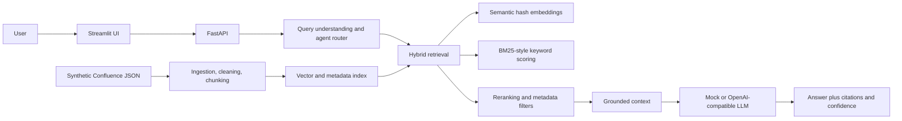

# Enterprise RAG Knowledge Assistant

A portfolio-quality, synthetic Confluence-style enterprise knowledge assistant built with FastAPI, Streamlit, Pydantic, SQLAlchemy-ready configuration, hybrid retrieval, reranking, and grounded answers. It runs in mock mode without an LLM API key and contains no client or proprietary data.

## Business Problem
Enterprise teams lose time searching operational documentation. This project demonstrates an assistant that retrieves relevant procedures, filters by authorization, cites source chunks, and refuses unsupported questions instead of inventing an answer.

## Architecture


## RAG Workflow
Documents are extracted from synthetic JSON, cleaned for prompt injection, split into section-aware chunks, enriched with page metadata, embedded locally, and indexed. At query time, semantic similarity and keyword overlap are combined, title/section signals rerank candidates, and role filters are applied before context reaches the answer generator.

## Retrieval Strategy
The default retriever is dependency-light and deterministic: hashed local embeddings provide semantic similarity, token overlap provides keyword matching, and a weighted hybrid score is reranked with title and section bonuses. The interfaces are deliberately replaceable with FAISS, PostgreSQL pgvector, or a production embedding service.

## Agent Workflow and Tools
`KnowledgeAgent` routes requests to query, search, summarize, compare, metadata search, and page retrieval operations. The public tool functions are `search_documents`, `search_confluence`, `retrieve_page`, `search_by_metadata`, `summarize_page`, and `compare_documents`.

## Security
The design is authentication-ready with bearer-token middleware, document-level role permissions, metadata filtering, PII redaction helpers, secret-free structured logs, and prompt-injection sanitization. Retrieved text is treated as untrusted data; instructions inside documents never override the system behavior.

## Evaluation
`evaluation/questions.json` contains 40 questions covering simple, multi-document, ambiguous, missing-information, conflicting/operational, multi-hop, metadata, and prompt-injection cases. `scripts/run_evaluation.py` reports retrieval precision/recall, citation correctness, groundedness, hallucination rate, and latency. These are lightweight portfolio metrics, not a substitute for human evaluation.

## API
- `GET /health`
- `GET /api/v1/health`
- `POST /api/v1/query`
- `POST /api/v1/documents`
- `GET /api/v1/documents`
- `GET /api/v1/documents/{page_id}`

Query responses include the answer, supporting evidence, source document, section, page/chunk identifier, confidence, request ID, retrieved chunks, and latency.

## Run Locally
```bash
python -m venv .venv
# Windows: .venv\Scripts\activate
pip install -r requirements.txt
copy .env.example .env
uvicorn app.main:app --reload
```
Open `http://localhost:8000/docs`. In another terminal run `streamlit run streamlit_app/app.py` and open `http://localhost:8501`.

Mock mode is enabled by default. To use an OpenAI-compatible provider, set `MOCK_LLM=false`, `OPENAI_API_KEY`, and optionally `OPENAI_BASE_URL` and `OPENAI_MODEL` in `.env`.

## Docker
```bash
copy .env.example .env
docker compose up --build
```
The API is available at `http://localhost:8000`; the UI is at `http://localhost:8501`. PostgreSQL is included for production-shaped deployment configuration; the demo index remains deterministic and local.

## Testing and Evaluation
```bash
pytest -q
python scripts/run_evaluation.py
```

## Screenshots
The Streamlit interface is intentionally screenshot-ready with a document explorer, query history, source citations, confidence, latency, and expandable retrieved chunks. Add captured screenshots to `docs/screenshots/` when publishing a portfolio fork.

## Limitations
The default embedding model is deterministic hashing, the demo repository is in memory, and evaluation metrics use expected source overlap. A production deployment should use managed identity, a durable database/vector index, audited permissions, stronger reranking, tracing, rate limiting, and human-reviewed evaluation sets.

## Future Improvements
Add pgvector persistence, incremental Confluence connector sync, cross-encoder reranking, streaming responses, feedback capture, OpenTelemetry traces, per-tenant isolation, and an automated red-team evaluation suite.

## Example Questions
- What is the rollback process?
- Who owns the data pipeline?
- What are the recovery objectives?
- What should I inspect for elevated API errors?
- What is the quarterly marketing forecast?

## Example Output
A rollback query returns a grounded answer, evidence from the Deployment Guide, a `KB-002-C...` chunk citation, and a confidence score. An unsupported forecast query returns: `I could not find sufficient information in the knowledge base.`

## GitHub Push
```bash
git init
git add .
git commit -m "Build enterprise RAG knowledge assistant"
git branch -M main
git remote add origin https://github.com/<your-user>/enterprise-rag-knowledge-assistant.git
git push -u origin main
```

## Resume Bullets
- Built a synthetic enterprise RAG assistant with FastAPI, Streamlit, hybrid semantic/keyword retrieval, reranking, citations, and grounded mock/API LLM modes.
- Implemented document-level authorization, prompt-injection defenses, PII redaction, structured observability, evaluation metrics, and Docker Compose deployment.
- Created a 40-question evaluation suite covering multi-hop, missing-information, security, and multi-document retrieval scenarios.

## 60-Second Interview Explanation
This project models an enterprise knowledge assistant over synthetic Confluence pages. Documents are cleaned, chunked with metadata, embedded, and indexed. A query uses role-filtered hybrid retrieval that combines semantic and keyword signals, then reranks results before passing only evidence-bearing chunks to a grounded answer generator. Every response has citations and confidence, and unsupported questions are refused. The system is mock-first for reproducibility but can switch to an OpenAI-compatible API and a durable database/vector store.

## 5-Minute Technical Explanation
The ingestion pipeline validates documents with Pydantic, removes untrusted instruction patterns, preserves page metadata, and creates bounded chunks. The repository abstracts storage, while the retriever computes deterministic vector similarity plus token-overlap keyword relevance. Authorization is enforced before scoring. Reranking adds title and section relevance. The RAG service records request IDs and latency, generates an answer only from retrieved evidence, and returns structured citations. FastAPI exposes query and document APIs; Streamlit provides exploration and query history. Tests cover ingestion, metadata, retrieval, citations, prompt injection, API errors, and refusal behavior. Docker Compose packages API, UI, and PostgreSQL-shaped infrastructure.

## Interview Questions and Answers
**Why hybrid retrieval?** Semantic search handles paraphrases; keyword search protects exact operational terms such as SEV-1, RPO, and rollback.

**How do you reduce hallucination?** Apply authorization and relevance thresholds, pass only retrieved evidence, require citations, expose confidence, and refuse when evidence is insufficient.

**How do you handle prompt injection?** Retrieved documents are untrusted. Known instruction patterns are sanitized and never treated as executable control messages.

**How would you productionize it?** Replace the in-memory repository with PostgreSQL/pgvector, use managed embeddings, add cross-encoder reranking, SSO, tenant isolation, OpenTelemetry, rate limits, and human-reviewed evaluation.

**What does the evaluation measure?** Source overlap for retrieval precision/recall and citation correctness, groundedness/refusal behavior, latency, and a reportable hallucination rate.
